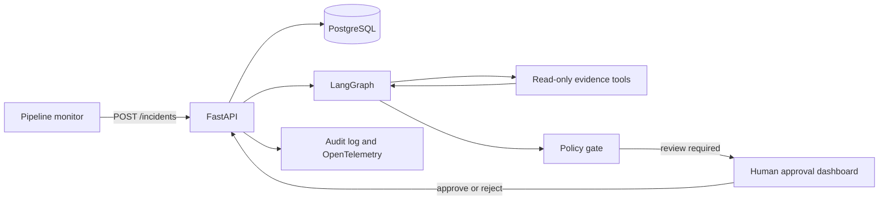

# AgentOps AI — bounded pipeline incident investigation

A runnable proof of concept for monitoring a data pipeline, collecting evidence, producing a constrained root-cause hypothesis, and asking a person to approve any remediation recommendation.

## What it demonstrates

- **LangGraph workflow:** typed state, fixed nodes, bounded evidence collection, structured investigation output, policy gate, and terminal human-review state.
- **FastAPI service:** create/list incidents, run investigation, inspect audit history, and approve or reject a proposed remediation.
- **Human control:** approving a recommendation records the decision. This demo deliberately does not execute production changes.
- **Persistence:** SQLAlchemy models work with SQLite locally and PostgreSQL in deployment. `deploy/init.sql` enables `pgvector` and documents the embedding index extension point.
- **Observability:** structured audit events, request IDs, and OpenTelemetry FastAPI instrumentation when enabled.
- **Dashboard:** small static incident console served by the API.
- **Testing:** pytest cases for workflow limits, tool allowlisting, evidence validation, and approval transitions.

## Architecture



### Safety boundaries

1. A run has a maximum of **three** evidence-tool calls, a fixed allowlist, a 15-second model timeout, and bounded output fields.
2. The investigator receives only the incident summary and collected evidence. It cannot write to the monitored system.
3. The recommendation must name one of the enumerated actions and pass schema and policy validation.
4. The API's approval endpoint stores a human decision; it does not dispatch the action. Add a separately authenticated, idempotent change executor only after integrating organization-specific authorization and rollback controls.
5. Treat pipeline logs as untrusted input. They are evidence, never instructions.

## Quick start (local)

Requires Python 3.11+.

```bash
cd agentops-ai
python -m venv .venv
source .venv/bin/activate        # Windows: .venv\\Scripts\\activate
pip install -r requirements.txt
uvicorn app.main:app --reload
```

Open `http://127.0.0.1:8000/` for the dashboard and `http://127.0.0.1:8000/docs` for the API. Local mode uses `./agentops.db`; set `DATABASE_URL` for PostgreSQL. If `OPENAI_API_KEY` is absent, the workflow uses a predictable local investigator so the demo works offline.

Create and investigate a sample incident:

```bash
curl -X POST http://127.0.0.1:8000/incidents \
  -H 'Content-Type: application/json' \
  -d '{"pipeline":"orders-hourly","severity":"high","summary":"Freshness SLA missed by 42 minutes","observed_at":"2026-11-17T14:10:00Z","labels":{"source":"warehouse"}}'
```

Copy the returned `id`, then:

```bash
curl -X POST http://127.0.0.1:8000/incidents/INCIDENT_ID/investigate
curl http://127.0.0.1:8000/incidents/INCIDENT_ID
curl -X POST http://127.0.0.1:8000/incidents/INCIDENT_ID/decision \
  -H 'Content-Type: application/json' \
  -d '{"decision":"approved","reviewer":"gouravi@example.com","comment":"Checked the upstream delay"}'
```

The sample evidence tools return deterministic fixture data. Replace them with read-only connectors for Airflow, Dagster, dbt, a warehouse, or your observability platform. Keep credentials scoped to read-only access.

## API overview

| Method | Path | Purpose |
|---|---|---|
| `POST` | `/incidents` | Persist a new monitored incident |
| `GET` | `/incidents` | List incidents (filter with `?status=`) |
| `GET` | `/incidents/{id}` | Read incident and recommendation |
| `POST` | `/incidents/{id}/investigate` | Run the bounded graph and persist its result |
| `POST` | `/incidents/{id}/decision` | Record a human approval or rejection |
| `GET` | `/incidents/{id}/audit` | Inspect append-only audit events |
| `GET` | `/health` | Liveness check |

## Project map

- `app/main.py` — API routes, persistence orchestration, dashboard hosting.
- `app/graph.py` — LangGraph nodes, call budget, tool allowlist, fallback investigator.
- `app/tools.py` — read-only fixture tools and evidence validation.
- `app/models.py` — incident and audit tables.
- `app/schemas.py` — request/response contracts and strict recommendation schema.
- `app/observability.py` — trace/log setup.
- `web/index.html` — incident review dashboard.
- `tests/` — API and workflow tests.
- `deploy/` — PostgreSQL, Docker Compose, and Kubernetes examples.

## Production hardening checklist

- Replace demo auth with SSO/OIDC and role checks for reviewers; never trust the `reviewer` string by itself.
- Store secrets in a secret manager; use TLS and database least-privilege accounts.
- Add tenant scoping, retention policy, PII redaction, request rate limits, and idempotency keys.
- Add model/provider governance, prompt/version records, output quality evaluation, and explicit data residency settings.
- Use pgvector for retrieval only if historical incidents/runbooks improve investigation quality. Filter by tenant, pipeline, and permissions before similarity search; citations should point to retained evidence IDs.
- Add an outbox and separately authorized remediation worker if action execution is eventually required. Make the worker idempotent and require rollback plans.

This is a teaching PoC, not a production incident-response system.
